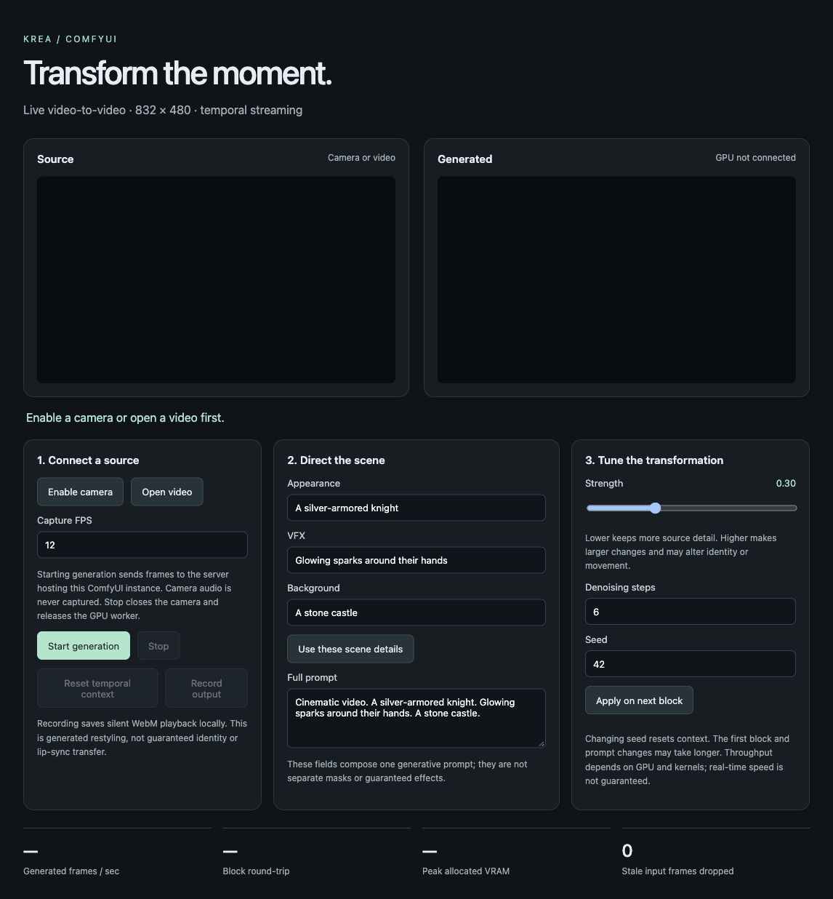

# ComfyUI · Krea Realtime Video

Competition review: see `SUBMISSION_CHECKLIST.txt` and `THIRD_PARTY_NOTICES.txt`.
This is a candidate entry, not a certified or submitted entry. GPU execution,
reproducibility, publication and submission materials remain outstanding.

Custom ComfyUI nodes and a browser studio for **Krea streaming video-to-video**: connect a camera or video, describe a different appearance, visual effects and background, and receive generated frames incrementally.

**Status: implementation complete for first GPU validation; inference speed and visual quality have not yet been tested on a GPU.** CPU protocol tests, dependency checks, official model API imports/meta construction, and browser interface checks are recorded in [VALIDATION.md](VALIDATION.md). There is no simulated inference mode in the shipped application.



## What is included

- **Krea · Prompt & Settings**: prompt, transformation strength, denoising steps and seed.
- **Krea · Live Camera Studio**: opens a separate browser panel on the same ComfyUI server. No additional exposed service or local tunnel.
- **Krea · Load Video Clip (30s max)**: samples a source clip at up to 12 fps, center-cropped to 832 × 480.
- **Krea · Streaming Video to Video**: processes IMAGE batches through the same stateful pipeline and returns IMAGE frames plus measured timing data.
- [Live camera workflow](workflows/01-live-camera.json) and [video-to-video workflow](workflows/02-video-to-video.json).
- An isolated, persistent GPU worker; pinned installer; model manifest; GPU smoke-test script.

The studio includes camera/local-video input, appearance/VFX/background prompt composition, live prompt/strength/steps updates, context reset, side-by-side preview, silent WebM recording, generated FPS, block round-trip latency, GPU allocated memory, and stale-frame counts.

## GPU-host installation

Copy this entire folder to `ComfyUI/custom_nodes/ComfyUI-RealTimeVideo` on your **Linux NVIDIA GPU host**. Leave the local Mac copy as source code. Do not copy a runtime environment from another machine.

Start with an **RTX PRO 6000 Blackwell 96 GB** or another CUDA GPU with substantial VRAM. This is a sensible capacity target, not a measured speed guarantee. The default runtime uses CUDA 12.8 wheels and requires a compatible host driver. Budget around 50 GB for model artifacts plus space for the environment and temporary downloads; allocate at least 80–100 GB free disk. Host memory must also accommodate model loading and frame batches; 64 GB or more is a practical starting point.

Inside the GPU container:

```bash
cd /workspace/ComfyUI/custom_nodes/ComfyUI-RealTimeVideo
bash scripts/install_runtime.sh
```

The installer requires Python 3.11 and creates `.runtime` inside this node directory. It **does not upgrade or install model dependencies into ComfyUI's Python environment**. ComfyUI itself already provides Torch, NumPy, Pillow, aiohttp and PyAV. The clip workflow uses the core `SaveWEBM` node.

Optional installation locations:

```bash
KREA_INSTALL_PYTHON=/usr/bin/python3.11 \
KREA_VENV=/workspace/krea-runtime \
KREA_MODELS=/workspace/ComfyUI/models/krea-realtime \
bash scripts/install_runtime.sh
```

The installer writes `runtime.json` with absolute paths. Re-run it after moving environments/model folders. It downloads only the Krea transformer/code and Wan text encoder, tokenizer, VAE and scheduler, using fixed repository revisions. No model downloads occur merely by starting ComfyUI.

The installer disables the optional `HF_HUB_ENABLE_HF_TRANSFER` flag inherited
from some GPU container images. Installing `hf_transfer` with the container's
global `pip` does not install it in `.runtime`. If an older copy fails with
this error, retry using `HF_HUB_ENABLE_HF_TRANSFER=0 bash scripts/install_runtime.sh`.
The pip update notice is informational; it is not the cause of that failure.

If Hugging Face authentication is required, authenticate privately on the GPU host using its CLI. Never put tokens in workflows or browser fields. The installer uses Hugging Face's normal cached authentication.

Restart ComfyUI after copying the extension. Keep ComfyUI behind your existing authenticated HTTPS proxy. Use a regular Chrome/Edge window if an embedded browser blocks camera permission. HTTPS or localhost is necessary for browser camera access.

## Run the live workflow

1. Import `workflows/01-live-camera.json` into ComfyUI.
2. Edit **Prompt & Settings**, then click ComfyUI's **Run/Queue** once to pass those values to the studio node. This does not start the camera or model.
3. Click **Open Live Studio** on the node. You can also open `krea-live/studio` relative to the ComfyUI base URL, e.g. `https://your-host/proxy/8188/krea-live/studio`.
4. Click **Enable camera** and grant permission, or choose **Open video**. Source video files stay in the browser; sampled image frames are sent during generation.
5. Click **Start generation**. Wait for model loading and first-block kernel compilation. Subsequent blocks reuse loaded weights and temporal state.
6. Change the full prompt, or compose it from appearance/VFX/background fields. Click **Apply on next block**. Prompt, strength and step changes apply at the next submission; changing seed resets temporal context.
7. Use **Reset temporal context** between unrelated scenes. It becomes available between requests. **Stop** closes the camera, disconnects the session and terminates the worker to release its GPU memory. Starting again reloads the model.

The live studio runs independently of ComfyUI's job queue. Do not queue other GPU-heavy ComfyUI workflows while it is active; the separate worker is not part of ComfyUI's VRAM accounting. Start with ComfyUI freshly restarted if other models are still resident. Only one Krea live or batch session can own the worker at a time.

## Run a video clip

Put an MP4/MOV/WebM/MKV in `ComfyUI/input`, refresh the UI, import `02-video-to-video.json`, and select the file in **Load Video Clip**. Start with five seconds, 12 fps, strength 0.3 and six steps. Run the workflow. Output saves under `ComfyUI/output/Krea` using the core SaveWEBM node.

The loader caps source duration at 30 seconds and samples no more than 360 frames. Input and output image batches remain in host RAM; a 360-frame RGB float32 batch alone is roughly 1.6 GiB. Live streaming uses bounded buffers instead of accumulating a full video.

Output is silent. The clip workflow does not carry audio or promise lip synchronization. The initial decoded block has nine generated frames; batch mode resamples those to twelve to preserve source clip duration. Timing metrics count actual generated frames, not duplicates.

## First GPU test

After installation, validate model APIs without loading weights:

```bash
.runtime/bin/python scripts/check_model_api.py --model models/krea
```

Then use a non-sensitive test image for three real generated blocks:

```bash
.runtime/bin/python scripts/smoke_gpu.py \
  --model models/krea \
  --image /workspace/test-person.jpg \
  --output benchmark-output
```

Use the configured runtime/model paths instead if you customized the installer. The smoke test saves generated JPEGs and `metrics.json`. It repeats a still image to test execution, cold/warm block time and memory; it does not validate movement fidelity. Next test the live workflow with actual motion and prompt changes. Inspect `worker.log` for CUDA, memory or component loading errors.

## How the integration works

```text
Browser camera/video → 12-frame crop/encode buffer → same-origin WebSocket
  → ComfyUI route → isolated worker stdin/stdout → Krea ModularPipeline
  → persistent causal/context + VAE caches → JPEG frame block
  → browser bounded playback queue / optional local WebM recording
```

The backend uses the official model's `video_stream` input and a persistent `PipelineState`. It explicitly clears cached text embeddings and cross-attention context on prompt changes, starts every session with a fresh input-frame cache, and restores the VAE cache-clearing method on reset. A serial state subclass avoids Diffusers deep-copying all GPU caches each block.

Only 832 × 480 is exposed initially because the published pipeline config fixes attention token geometry. It accepts 12 input frames per block, emits nine on the first block and typically twelve thereafter. At 12 capture fps, collecting a block already takes approximately one second, before inference and transport. This is **chunked streaming**, not a zero-latency per-frame filter.

There is one request in flight and at most twelve pending input frames. If inference falls behind, stale input is dropped; playback is bounded to two blocks. Low latency is prioritized over retaining every live source frame. A faster GPU improves throughput but does not remove block collection delay. No 24/30-fps claim is made.

The appearance, VFX and background controls build one prompt. They are not independent segmentation layers. This model may restyle faces, clothing and scenery but does not guarantee exact reference identity, pose preservation, character replacement, independent multi-character control or lip movement transfer. No reference-image adapter or audio model is included.

## Security and dependency boundary

- Browser routes use the existing ComfyUI listener; no additional worker port, shell endpoint, tunnel or arbitrary URL fetch.
- WebSocket handshakes require matching Origin/Host. If a reverse proxy rewrites Host, configure it to preserve the public Host; do not disable the check.
- **Origin checks are not authentication.** ComfyUI must remain behind authentication; anyone authorized to access this instance can use these nodes. This package is not a multi-tenant sandbox.
- Worker executable/model locations come from administrator-owned `runtime.json`, never browser input. Subprocesses launch with an argument list, not a shell.
- Payloads, image dimensions, frame queues and session ownership are bounded. Stop/disconnect kills the worker; no output accumulation on the server for live sessions.
- Model code is explicitly trusted only during the operator-initiated installation/load of the pinned official release. `trust_remote_code=True` executes that local code; repository pinning reduces unexpected changes but is not an independent security audit or sandbox.
- Worker inference uses offline Hugging Face settings and disables automatic Hub kernel downloads. This is an application setting, not OS-level network isolation.
- Camera microphone access is disabled. Frames go only to this ComfyUI host; logs may include errors and prompts, so treat the node folder as private. Recording stays in the user's browser until downloaded.

## Sources and versions

- [Krea model and streaming examples](https://huggingface.co/krea/krea-realtime-video/blob/9a2ceea280e5d584c6a28d384a9c19e38c810f8c/README.md)
- Krea revision: `9a2ceea280e5d584c6a28d384a9c19e38c810f8c`
- [Wan components](https://huggingface.co/Wan-AI/Wan2.1-T2V-14B-Diffusers/tree/38ec498cb3208fb688890f8cc7e94ede2cbd7f68)
- Wan revision: `38ec498cb3208fb688890f8cc7e94ede2cbd7f68`
- Diffusers 0.36.0, PyTorch 2.8.0/CUDA 12.8, Transformers 4.57.1. Direct worker dependencies are pinned in `requirements-worker.txt`; the installer records resolved transitive versions in `runtime-freeze.txt`.

Extension code is MIT. Downloaded model weights, code and dependencies keep their own licenses. The Hugging Face Krea model card identifies Apache-2.0; review its pinned model card and the Wan component terms for your use. This package does not vendor the separate legacy Krea GitHub server.

### Reverse-proxy WebSocket origin configuration

If Studio opens but Start reports a connection failure and ComfyUI logs an origin
rejection, the reverse proxy may rewrite the Host header. Set `KREA_PUBLIC_ORIGIN`
in the **ComfyUI server process** to the exact browser origin (scheme and hostname,
plus port if present; no path, `/api`, query string or token), then restart ComfyUI:

```bash
export KREA_PUBLIC_ORIGIN='https://YOUR-POD-8188.proxy.runpod.net'
# Start ComfyUI with your usual command in this same shell.
```

This explicitly pins the accepted browser origin; arbitrary forwarded headers and
other origins remain rejected. Update it if the pod URL changes. The `/api/` prefix
is supported by the relative Studio WebSocket URL. No installer rerun or model
download is required for this configuration. Origin rejection occurs before the
worker starts, so it appears in ComfyUI's log rather than `worker.log`.

### LTX backend (experimental, self-hosted)

Krea remains the default. Live Studio now has a **Backend** selector, and
`workflows/03-ltx-live-camera.json` prepares LTX settings. Stop generation before
switching; one worker owns the GPU at a time. Existing Krea workflows and its
runtime remain compatible. The `RTVideoSettings` node can also feed the existing
batch renderer; use the clip loader's FPS as the settings FPS.

The initial LTX backend uses **Lightricks/LTX-Video-0.9.7-distilled (13B)**, pinned
at `057509edea1493cae5e62e9d8f780ebda3fb4333`. It is **not LTX-2.5**, a Reactor
integration, or a causal streaming checkpoint. It conditions 17-frame windows on
incoming video and the last generated frame; it delivers 12 new frames per call.
The remaining frames are an anchor and padding. This is an experimental continuity
heuristic and may flicker, drift, or fail to preserve identity. Output is silent,
512 × 320; it is not stretched to the Krea resolution in Studio. The text prompt
embeddings are cached until the prompt changes. Strength maps inversely to LTX's
source-conditioning strength; it is not identical to Krea's denoising strength.

Install **on the Linux GPU host**, after pulling your pushed changes:

```bash
cd /workspace/ComfyUI/custom_nodes/ComfyUI-RealTimeVideo
bash scripts/install_ltx_runtime.sh
```

This creates `.runtime-ltx`, `runtime-ltx.json`, and `models/ltx`, independently
of Krea. It downloads pinned safetensors and tokenizer/config files, not remote
Python code. Model licensing is separate from this node pack's MIT license;
review the official model license before using/distributing its weights.
No model downloads occur during ComfyUI startup or generation.

Restart ComfyUI with your existing `KREA_PUBLIC_ORIGIN` setting, refresh Studio,
select **LTX**, and begin with **12 capture FPS, 7 steps, strength 0.3**. Capture
FPS is a sampling target, not a generation-speed promise. `Generated frames/sec`
counts the 12 delivered frames, including inference/prompt-encoding time but
excluding network and JPEG encoding; it excludes the five discarded model frames.

First run a repeatable smoke test (replace the image path with a real file):

```bash
.runtime-ltx/bin/python scripts/smoke_gpu.py \
  --backend ltx --model models/ltx \
  --image /workspace/ComfyUI/input/test.png --output benchmark-ltx
```

This saves three blocks of actual output and `benchmark-ltx/metrics.json`. The
still-image test establishes execution and cold/warm throughput, not motion
fidelity. Then test camera movement and inspect transitions between chunks.
No GPU inference, real-time rate, or 5090 fit is claimed by local CPU tests.

Default `offload: model` in `runtime-ltx.json` moves complete components between
CPU and GPU; it avoids placing the text encoder and transformer on GPU together.
Allow substantial system RAM for the BF16 weights (64 GB or more is a sensible
starting allocation, not a measured minimum). If the 5090 still runs out of VRAM,
set `offload` to `sequential` in that file, stop/start the Studio session, and retry.
This moves smaller modules and may be much slower. The smoke test takes
`--offload sequential` independently of the config file. A larger GPU can use
`offload: none`, after memory has been checked. Do not alter the Krea config.

Read `worker.log` immediately after a failure; the next session overwrites it.
The same origin protection applies to both backends. No new exposed worker port
or third-party inference service is introduced.

### LTX-2.5 on the B200 (new backend)

Select **LTX-2.5** in Studio, or load `workflows/04-ltx25-live-camera.json`.
Krea and legacy LTX 0.9.7 remain separate choices. This backend uses native
Lightricks code, **LTX-2.5 22B distilled BF16**, the bundled Gemma 4 12B text
encoder, and the LTX-2.5 convolutional video VAE. It does not load 0.9.7 weights.
Source and model revisions are pinned in `realtime/ltx25_config.py`.

After pushing/pulling these changes, install on the GPU host:

```bash
cd /workspace/ComfyUI/custom_nodes/ComfyUI-RealTimeVideo
git pull --ff-only
bash scripts/install_ltx25_runtime.sh
```

Use Python 3.11 (`LTX25_INSTALL_PYTHON` overrides the executable). This creates
`.runtime-ltx25`, `.ltx25-source`, `models/ltx25` and `runtime-ltx25.json`, without
changing ComfyUI, Krea or the legacy LTX environments. The native runtime needs
Transformers 5.14.1 for Gemma 4, with its own compatible safetensors version.
It uses Torch 2.8 / CUDA 12.8 without optional compiled kernels or quantization.
The installer checks CUDA, imports, dependency consistency, and downloaded file
sizes/SHA256 before publishing the runtime config. Allow space for roughly
70 GB of model weights plus the runtime/cache, and adequate host RAM for cached
weights. No weights or source checkout are committed to this project.

If Hugging Face returns 401/403, review the LTX-2.5 access conditions yourself and
authenticate privately in the new runtime (`.runtime-ltx25/bin/hf auth login`),
then rerun the installer. Existing machine-wide Hugging Face authentication is
normally reused. Never put an access token in a workflow or commit it.

Restart ComfyUI with `KREA_PUBLIC_ORIGIN` set to your **new pod's** browser origin.
The variable name remains unchanged and protects every backend. Refresh Studio,
choose LTX-2.5, and start with 12 capture FPS and strength 0.3. Weights are loaded
lazily on the first generated block, which can take substantially longer than
later blocks; the session timeout allows up to 15 minutes per native LTX call.
Stop still terminates the worker.

Run a repeatable GPU smoke test first (replace the image path):

```bash
.runtime-ltx25/bin/python scripts/smoke_gpu.py \
  --backend ltx25 --model models/ltx25 \
  --image /workspace/ComfyUI/input/test.png --output benchmark-ltx25
```

The test saves actual generated frames and hardware/timing metrics. If you used
`LTX25_MODELS` to reuse an existing folder, pass that folder to `--model`.
Default native offload is `none` for the B200. `cpu` and `disk` in
`runtime-ltx25.json` enable native weight streaming if needed, at a speed cost;
these names differ from legacy Diffusers offload options. The smoke test accepts
`--offload cpu` or `--offload disk` independently of the config.

**What is implemented:** source frames are encoded into video latents, mixed
with noise, and text-guided denoised using native model blocks. The previous
output frame anchors the next window. Each window has 17 model frames; only the
12 new frames are delivered, at 768 × 448. Audio is omitted, no IC-LoRA is loaded,
and no spatial upsampler or diffusion VAE pass is used. This is an experimental
single-stage video-to-video adaptation, not the stock two-stage quality recipe
or a trained causal streaming system. Identity, motion, seam quality and speed
must be assessed on the B200; a bigger GPU does not itself establish real-time
performance. Model blocks manage their own weight lifecycle; this first version
does not include CUDA graphs or a fully GPU-resident optimized streaming engine.

The model uses a **fixed distilled schedule of up to eight steps**. The Steps
field is disabled in Studio (ignored for this backend in workflow settings).
Strength rounds up to the next supported starting noise level, then uses the
remaining schedule: e.g. 0.3 → 0.421875 with one denoising step. `effective_noise`
and `denoising_steps` are included in benchmark metrics. Strength 0 is explicit
source passthrough and reports zero generated FPS. These controls are not
identical to the Krea/legacy-LTX controls. Very high strength can discard source
performance; low strength may change appearance only slightly.
